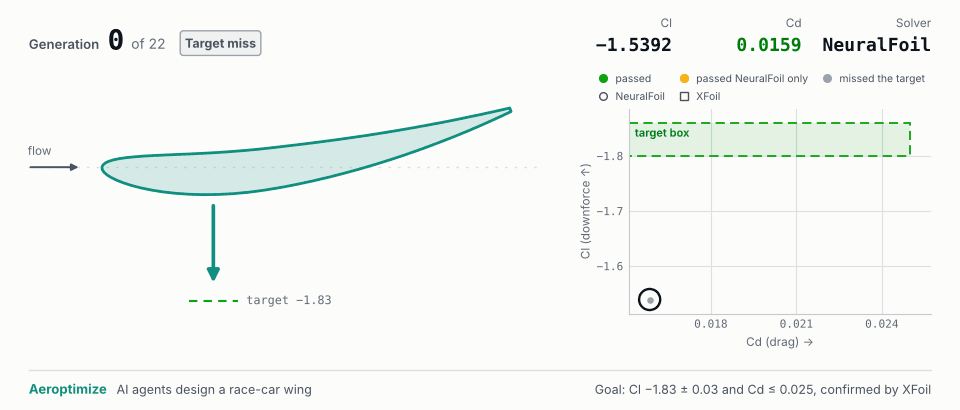

# Aeroptimize

<p align="center">
  <a href="https://aeroptimize.anjaneyabhardwaj.com">
    <picture>
      <source media="(prefers-color-scheme: dark)" srcset="viewer/media/replay-dark.gif">
      
    </picture>
  </a>
</p>

Live demo: [aeroptimize.anjaneyabhardwaj.com](https://aeroptimize.anjaneyabhardwaj.com) (how it works, for everyone, and
recorded runs replayed).
The GIF above is the example run's replay, drawn from its exported ledger (`make readme-gif`).

Multi-agent LLM system that optimizes a race-car wing section against Cl/Cd
targets. LLM agents (Chief, CAD, Critic) emit typed Pydantic schemas;
deterministic code builds geometry, runs NeuralFoil/XFoil and validates.
Built as AeroSwarm: the code still uses that name internally (the Python package, the `AEROSWARM_*` settings).
Design: [docs/BLUEPRINT.md](docs/BLUEPRINT.md). Status: [docs/PROGRESS.md](docs/PROGRESS.md).

```bash
make install   # uv sync
make xfoil     # build headless-safe XFoil 6.99 (the apt package aborts with SIGFPE)
make test      # offline; XFoil-binary tests skip if it is missing
make demo      # smoke test: real LLM if AEROSWARM_ANTHROPIC_API_KEY (or ANTHROPIC_API_KEY) is set, else the labelled mock (NOT an LLM)
make demo-hard # mock, hard target Cl -1.83 ± 0.03, Cd <= 0.025 at Re 3e5 (near the gated Cl,max)
```

Rules: the section is checked against the **Formula SAE Rules 2027 v1.0**
([docs/FSAE_Rules_2027_V1.pdf](docs/FSAE_Rules_2027_V1.pdf)), on outlines placed on a placeholder
car (`PLACEHOLDER_CAR`, not a real car): T.7.7.1 height (≤ 1200 mm in the Rear Aerodynamic Zone,
≤ 500 mm outside it), T.7.5b (≤ 250 mm behind the rear tires), T.7.1.4 (5 mm radius on forward
facing horizontal edges, so NACA thickness ≥ 0.123 on the 300 mm chord), T.7.1.5 (edges not sharp:
the trailing edge is kept ≥ 2 mm thick) and V.1.4.1 (no ground contact). Width (T.7.6) and end
plates need the 3D stage. `DesignSpec.rulebook = "FS2026_v1.1"` selects Formula Student 2026, the project's first
rulebook: the committed example run (1 Oct 2026) was checked against it, so its wings were shaped for a 3 mm
leading-edge radius, not FSAE's 5 mm. Known gap: the 5 mm check uses the NACA formula (r ≈ 1.1019 t²c), and on
strongly cambered sections the generated nose is tighter than that; see "Known gaps" in docs/BLUEPRINT.md.

Live runs: cap them. `python -m swarm.run --llm anthropic --max-evals 10 --budget-usd 2`
stops cleanly (termination `cost_cap`) once the estimated LLM spend reaches the cap;
calls whose model has no entry in `PRICES` count as over the cap.
`--llm anthropic` needs `AEROSWARM_ANTHROPIC_API_KEY` (or the SDK's `ANTHROPIC_API_KEY`) and fails at startup without either. A real-LLM run with more
than 2 failed LLM calls is aborted, and one in which any agent never got a successful call is invalid
(termination `invalid_llm`, exit code 3, `require_real_llm()` refuses it). `report.md` and `meta.json`
show per-agent ok / failed / fallback counts.

Each run writes `runs/<id>/`: `ledger.jsonl`, `events.jsonl`, `traces.jsonl`
(tokens + estimated cost), `report.md`, `evolution_strip.png`, `evolution_morph.gif`,
`stall_<cid>.png` for each XFoil stall-margin probe, and `ckpt.db` (resume with
`python -m swarm.run --resume <id>`). `report.md` names the best *passing* design (a full
XFoil PASS) or says there is none, and then shows the closest candidate with its failing
checks; it never calls a TARGET_MISS "best". Termination is one of `target_met`,
`eval_budget`, `wall_clock`, `cost_cap`, `plateau`, `fatal`, `invalid_llm`.

Before a NeuralFoil candidate is promoted to XFoil it must pass the NeuralFoil screen:
d|Cl|/dα ≥ 0.055/deg and suction-side TE shape factor H < 4.35 at α+1 and α+2, and H < 4.25 at α
(cost-weighted calibration on the gated Re 3e5 XFoil sweep: `scripts/calibrate_screen_rules.py`).
The Chief may overrule the screen with a logged `screen_override` reason, at most twice per run and
only for a design whose NeuralFoil result is inside the target box; every brief shows its override
record. XFoil's own gates stay authoritative; an XFoil result whose stall probe did not run is
labelled `stall_untested` and is not counted as evidence about the screen.

Hybrid optimization (milestone 4): the Chief may set `mode="inner_optimizer"`, which hands its
focus parameters, within the trust region around the CAD base, to Optuna TPE
(`swarm/optim/inner_loop.py`) for 3–12 NeuralFoil evaluations, warm-started from the ledger. The
loop is deterministic (no LLM call), uses the same geometry checks, validator and screen, and every
evaluation is a ledger record counted in `max_evals`; it never promotes, the Chief does.
`--no-inner-optimizer` makes an LLM-only run. Benchmark: `scripts/benchmark.py` (arms hybrid, llm,
mock, mock_hybrid, random, optuna; `docs/BENCHMARK4.md`).

Evaluations of the system (milestone 2, `swarm/evals/`): every run report has an "XFoil recovery
ladder" section (design-point and stall-probe solves by the level that produced them, recoveries,
exhausted ladders) and a "CAD sign predictions" section (the CAD agent's predicted ΔCl/ΔCd signs
against the measured change from the parent), both from the ledger. The XFoil failure zoo
(`scripts/failure_zoo.py`, cached in `evals/xfoil_zoo.json`, `docs/FAILURE_ZOO.md`) solves stress cases
at every ladder level and reports recovery rates and level-to-level disagreement.

Vision Critic (milestone 3): with `--vision` the Critic is also shown three deterministic images
(`swarm/critic/render.py`): Cp(x/c), the suction-side boundary layer, and the section in the car frame,
candidate over parent. Images can only downgrade a result, never rescue a failed numeric check. It is off by
default: on the labelled Critic failure zoo (`scripts/critic_eval.py`, `docs/CRITIC_EVAL.md`) the images added
nothing. What did help is deterministic: the validator checks the reported Cl against the Cl integrated from
the solver's own surface Cp, and an XFoil Cp for non-physical local spikes (`swarm/critic/surface.py`); with
them the numeric validators alone catch 10 of the zoo's 15 bad cases with no false alarm.

OpenFOAM tier (milestone 5): `swarm/solvers/openfoam` meshes a structured 2D O-grid, runs simpleFoam
(k-omega SST) and integrates the forces from the fields (`of2d` results); validated on NACA 0012 at Re 6e6
(`scripts/of_validate.py`, `docs/OPENFOAM.md`) with a mesh-independence study (`docs/OPENFOAM_MESH.md`). A failed
solve goes through a recovery ladder (L1 relaxation, L2 first-order start, L3 potential-flow initialisation, L4
re-mesh, L5 fall back to XFoil); the CFD agent picks the level from the failure record and code forbids repeats
(`docs/OPENFOAM_RECOVERY.md`). With `--of2d` the Chief may promote a design that has an XFoil result to OpenFOAM.
At the project's Re 3e5, fully turbulent SST predicts less downforce than XFoil (transition), so of2d is a
cross-check there, off by default.

Limits: 2D sections only (no endplates, tip vortices or induced drag);
validator thresholds are project conventions to calibrate, not published limits.
